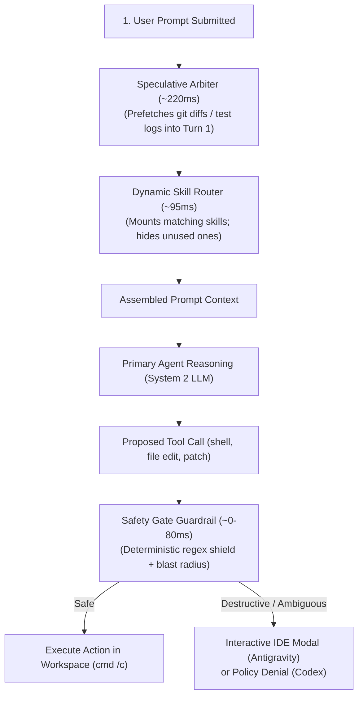
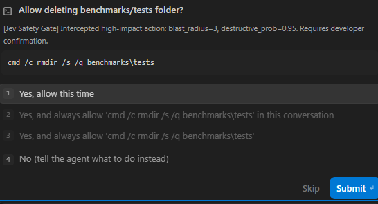

# Jev System One Control Layer: User Guide & Operational Manual

> **Audience**: Developers operating Antigravity, Codex, OpenCode, or Codex-based T3 Code
> **Status**: Production Standard (Unified Shared Runtime)
> **Runtime Platforms**: Windows and Linux, Python 3.10+
>
> **Installer Coverage**: Codex user setup is cross-platform; full Antigravity/Codex/OpenCode setup is currently PowerShell on Windows
> **Foundational Concepts**: [The Philosophy of Jev](PHILOSOPHY.md) | [Architecture Spec](ARCHITECTURE.md)

---

## 1. Quick Start (60 Seconds)

Get Jev installed and verified in your environment in three steps.

### Step 1: Install Package & Core Tools
From the repository root:
```sh
python -m pip install --user -e ".[mcp]"
jev doctor --cwd .
```

The editable install is the development mode: the `jev` command on this device loads this checkout. Each device has its own checkout and user-level harness config; use Git to move source changes between checkouts.

### Step 2: Install and verify the Codex user integration
From the repository root on each device:
```sh
python scripts/codex_hooks.py install
python scripts/codex_hooks.py check
```

The installer merges the tracked [Codex hook template](../.codex/hooks.template.json) into that device's user `hooks.json`, preserves unrelated handlers, and ensures the user-level Jev MCP server is present. It stops if the current project already registers Jev locally. Keep Jev hook and MCP registrations out of project scope; Codex loads matching hooks from both scopes. If the template changes, Codex may ask you to review and trust the new hook definition on that device.

On Windows, the all-harness user installer also configures Antigravity and OpenCode:
```powershell
powershell -ExecutionPolicy Bypass -File scripts/install-user-harnesses.ps1
```

That script calls the same Codex installer, so Codex hook merging has one implementation.

### Step 3: Configure the machine-wide provider key
For all workspaces and harnesses, store the provider key in `~/.config/jev/.env`:
```sh
mkdir -p ~/.config/jev
chmod 700 ~/.config/jev
$EDITOR ~/.config/jev/.env
chmod 600 ~/.config/jev/.env
```

Add this line:
```ini
OPENROUTER_API_KEY=sk-or-v1-your_openrouter_api_key_here
```
Jev loads this machine-wide file from every workspace. Environment variables already present in the harness process take priority. A project `.agents/.env` or `.env` can override the machine key intentionally.

All harnesses write to one local database, `~/.local/share/jev/jev.sqlite3`, unless the trusted machine config changes it. Check paths and log counts with `jev doctor --cwd .` and `jev stats --json`.

### Step 4: Run Self-Diagnostics
```sh
jev doctor --cwd .
jev stats --json
```

---

## 2. Connecting to Your Agent Harness

Jev uses one editable Python runtime from this checkout (`src/jev/`). Each device installs that checkout into its user Python environment, then its user-level harness registrations invoke the `jev` command. T3 Code sessions use the same Codex registration when running through the Codex hook layer.

### A. Antigravity

The global `~/.gemini/config/hooks`, `hooks.json`, and `skills` paths link to `.agents/` in this checkout.

### B. Codex and T3 Code

The global `~/.codex/hooks.json` is installed from [`.codex/hooks.template.json`](../.codex/hooks.template.json). The project `.codex/hooks.json` stays empty, and the project `.codex/config.toml` does not register Jev MCP. This keeps both hooks and tools in one scope. Jev skill links under `~/.codex/skills/` point to the canonical skill files in `.agents/skills/`.

T3 Code sessions share these hooks when T3 Code runs the local Codex hook system. If a T3 Code deployment runs in a separate host or does not load Codex hooks, it needs its own native bridge to the same `jev` executable and user data directory.

### C. OpenCode

The global `~/.config/opencode/opencode.json`, plugin, and `skills` paths link to `.agents/opencode/` and `.agents/skills/` in this checkout. The thin JavaScript plugin translates OpenCode prompt and tool events into the shared Jev runtime; policy and feature logic remain in `src/jev/`.

The shared SQLite database is `~/.local/share/jev/jev.sqlite3`; Antigravity, Codex, OpenCode, and T3 Code through Codex write to this same file. `jev stats --json` summarizes the decision records by harness. Runtime records contain outcomes and feature data, not full user prompts or tool commands.

For development, push source commits from one checkout and fast-forward the other device's checkout. The editable package uses the updated source on the next hook call. Rerun the installer when a harness template changes, then restart that harness. Do not copy user `hooks.json`, trust approvals, or the SQLite database between devices: each installer merges the tracked template with that device's own settings, and the database is local state.

```sh
# On the device where you made the change
git add -p
git commit -m "Describe the Jev change"
git push

# On another development device
git pull --ff-only
python -m pip install --user -e ".[mcp]"
python scripts/codex_hooks.py install
python scripts/codex_hooks.py check
```

---

## 3. The Everyday Execution Flow

When an agent runs in your workspace, Jev operates transparently at two key lifecycle phases:



> **Grounding Tip: Preserving Your Project's Compass (Horizon 3)**
> Jev automatically discovers your project's North Star by checking common file conventions (`docs/GOAL.md`, `GOAL.md`, `PRD.md`, `docs/PRD.md`, or `.agents/GOAL.md`). It also falls back gracefully to `GEMINI.md` / `AGENTS.md`, `pyproject.toml` / `package.json` descriptions, or `README.md`. Having a clear 1–2 sentence goal statement grounds every System One micro-decision, preventing local myopia and goal drift across multi-turn sessions.

---

## 4. Safety Gate Modals & Rule Authorizations

When an agent proposes an action with high blast radius (`rmdir /s`, unverified git resets, destructive database operations), Jev halts execution instantly.

### Antigravity Interactive Modals
In Antigravity, Jev renders an interactive dialog directly in your IDE:



You can select:
- **Allow Once**: Authorizes this single execution.
- **Save for Session**: Authorizes this command pattern for the duration of the current conversation.
- **Save Always**: Writes a permanent grant to SQLite so you are not interrupted for this pattern again.
- **Cancel**: Aborts the operation safely.

### Managing & Auditing Saved Approvals
To maintain full sovereignty over permanent rules created via "Save Always", inspect and prune them at any time:

```cmd
cmd /c python .agents\hooks\safety_db.py --list
cmd /c python .agents\hooks\safety_db.py --delete <rule_id>
```

### Codex Permissions
In Codex, high-risk actions receive a clean policy denial explaining the exact blast radius. You can authorize a one-time execution via the CLI:

```cmd
cmd /c python -m jev authorize --harness codex --tool Bash --command "your command" --workspace-id WORKSPACE_ID
```
Review the printed operation digest, then confirm:
```cmd
cmd /c python -m jev authorize --harness codex --tool Bash --command "your command" --workspace-id WORKSPACE_ID --confirm-digest DIGEST
```

---

## 5. Output Verification & Knowledge Capture

### A. Output & Citation Verification
To prevent models from inventing unexported API symbols or hallucinating method parameters, Jev verifies proposed edits against local files and Knowledge Items:

```cmd
cmd /c python -m jev verify --code "client.get_token()" --reference "API Reference: client.get_token() retrieves active auth token."
```

- In **Antigravity**, discrepancies inject an advisory warning into prompt context without interrupting execution.
- In **Codex**, warnings appear in `hookSpecificOutput.additionalContext`.
- Agents can also call the `verify_output` MCP tool before writing complex diffs.

### B. Capturing Precedents (`knowledge_learn`)
When you establish a project-specific pattern or resolve a tricky convention, teach it to Jev so future turns auto-mount it:

```cmd
cmd /c python -m jev learn --title "API Client Timeout" --content "Always set timeout=10 on HTTP requests in services/client.py"
```
Or instruct your agent: *"Save this convention using `knowledge_learn`."*

---

## 6. Semantic Code Linting & Rule Lifecycle

Semantic lint rules inspect staged code changes against architectural standards that traditional syntax linters miss (layer boundaries, repository patterns, abstraction leaks).

Rules live under `.agents/lint-rules/<rule-id>/`:
- `metadata.json`: defines the machine contract and target glob patterns.
- `artifacts/policy.md`: documents the architectural rationale.

### Setting Up Rules with `lint-architect`
You can invoke the built-in **`lint-architect`** skill ([`.agents/skills/lint-architect/SKILL.md`](../.agents/skills/lint-architect/SKILL.md)) to scan your tech stack and author initial architectural rules tailored to your project.

### Rule Promotion Lifecycle
To ensure rules do not paralyze developer flow:
1. **`observe`**: New rules always start in observe mode. They run silently, recording predictions and latency without notifying the user.
2. **Review Telemetry**: Inspect false-positive rates with `cmd /c python -m jev lint-stats`.
3. **`advisory`**: Once validated, promote the rule to advisory mode in `metadata.json`. Findings inject non-blocking advice into context (`prompt_user` or `warn_user`).
4. **`ci_enforced`**: Optional strict mode for CI/CD gates (`python -m jev lint` exits with code 1 on confirmed violations).

### Running the Linter
```cmd
cmd /c python -m jev lint --staged --harness antigravity
cmd /c python -m jev lint --base origin/main --harness codex
cmd /c python -m jev lint-feedback 42 confirmed_violation
cmd /c python -m jev lint-stats --rule lr_repository_boundary
```

---

## 7. Telemetry, Database & CLI Auditing

Jev stores local audit records in `%LOCALAPPDATA%\Jev\jev.sqlite3`. Prompts and commands are never stored in full; secrets and sensitive environment keys are redacted before writing to disk.

### Inspecting Latencies and Decisions
```cmd
cmd /c python -m jev stats
cmd /c python -m jev stats --harness codex
cmd /c python -m jev stats --json
```

### Reviewing Safety History
```cmd
cmd /c python .agents\hooks\safety_db.py --review --harness antigravity
cmd /c python .agents\hooks\safety_db.py --review --harness codex
```

---

## 8. Multi-Workspace Codex Configuration

The Codex installer configures hooks and MCP tools once at user scope for all workspaces. Run it after installing Jev on each device:
```cmd
python scripts/codex_hooks.py install
python scripts/codex_hooks.py check
```

Do not add the same Jev server or hook to a project's `.codex/config.toml` or `.codex/hooks.json`. `check` exits with an error if it finds a project Jev registration, duplicate user hooks, missing user MCP configuration, or a `jev` executable unavailable on `PATH`.

---

## 9. Verification & Self-Test Suite

The offline test suite runs against isolated, temporary databases:

```cmd
cmd /c python -m pytest -q
```

To run live provider integration tests against OpenRouter / TypeSafe:
```cmd
cmd /c set JEV_RUN_LIVE_TESTS=1
cmd /c python -m pytest tests\test_speculative_router.py -q
```


### Diagnosing missing advice or repeated provider failures

On Linux, run `jev doctor --cwd /path/to/project`. On Windows, run
`cmd /c python -m jev doctor --cwd C:\path\to\project`. The report includes
catalog counts, missing catalog directories, and the semantic request timeout.
An empty project knowledge catalog is valid; it means there are no local items to search.

The default semantic request timeout is 2 seconds. Hook dispatch starts with a
4-second budget, shortened by any earlier native deadline. The three independent
turn-enrichment requests run concurrently. Optional features skip
when that budget expires; deterministic safety checks still run. Set
`semantic_timeout_seconds` in `jev.json` or the user config to tune the request
timeout, or override it with `JEV_SEMANTIC_TIMEOUT_SECONDS`.

To share skills across projects, add `skill_roots` to the user config at
`~/.config/jev/config.json` on Linux (or `%APPDATA%\Jev\config.json` on Windows).
Relative user roots resolve beside that config. Project skills take precedence
when a name also exists globally. `JEV_SKILL_ROOTS` replaces both root lists.
Knowledge remains scoped to the configured knowledge roots and project gotchas.

New audit events distinguish `empty_catalog`, `missing_prompt`, and
`dispatch_deadline_exceeded`. Their details include provider status, safe error
categories, and context item/character counts retained after the context budget.
`abstain` alone does not tell you whether advice was injected. Post-tool events
record `success`, `failure`, or `unknown`; missing exit status is not success.
Restart the harness after changing hook registrations or the OpenCode plugin.
